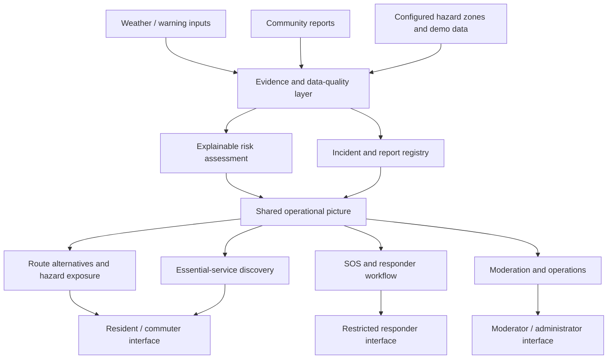

# FloodSense

### City-adaptive flood intelligence. Safer decisions when every minute matters.

**From uncertain signals to coordinated urban response.**

*An urban resilience platform concept developed for
Rain-Resilient Cities challenge, using Guayaquil, Ecuador, as its
initial demonstration environment.*

------------------------------------------------------------------------

## Idea

Flooding is not only a weather problem. It becomes a city-wide emergency
when people cannot tell which roads are passable, whether a reported
hazard is credible, where help is needed, or which essential services
remain reachable.

**FloodSense connects those decisions in one place.** It brings together
risk assessment, community observations, safer-route exploration,
essential-service discovery, SOS workflows, and responder operations—so
that residents and response teams can work from a shared operational
picture.

The goal is not to claim certainty where none exists. It is to make
available evidence easier to interpret, surface missing or stale
information, and help people make better-informed decisions under
pressure.

## Problem Story

| The real-world problem                                                                       | FloodSense’s response                                                                                                            |
|----------------------------------------------------------------------------------------------|----------------------------------------------------------------------------------------------------------------------------------|
| Rainfall and flooding can vary sharply between neighbourhoods.                               | Assess conditions at a location and expose the evidence and uncertainty behind the estimate.                                     |
| Official feeds may be delayed, incomplete, or unavailable.                                   | Distinguish known information from missing, stale, sample, or simulated data instead of silently treating gaps as safety.        |
| A route that is shortest on a map may cross a hazard.                                        | Compare route alternatives against available hazard zones and verified road reports, while making fallback limitations explicit. |
| Residents often have useful local observations, but reports may be duplicated or unreliable. | Provide a structured reporting and moderation workflow with corroboration and resolution states.                                 |
| A distress request needs a clear status and controlled access.                               | Keep SOS records separate from public incident listings and provide a responder-facing status workflow.                          |
| Emergency response involves more than predicting water.                                      | Connect incident reporting, essential services, response coordination, and operational oversight in one prototype.               |

## One platform, multiple roles

FloodSense is designed around a shared incident picture rather than
disconnected tools. Each role has a different job, while the underlying
reports and workflows remain connected.

<strong>Residents and commuters</strong>

- Review estimated local risk and available warnings.
- Report flooding, blocked roads, debris, drainage issues, and other
  hazards.
- Explore route alternatives and nearby essential services.
- Create and track a prototype SOS request.
- See when information is cached, stale, or unavailable.

<strong>Moderators and community verifiers</strong>

- Review incoming reports.
- Verify, reject, or resolve reports.
- Reduce duplicate noise and preserve a history of moderation actions.
- Help distinguish a single unverified observation from corroborated
  information.

<strong>Responders</strong>

- Review response incidents through a restricted workflow.
- Acknowledge, assign, update, or resolve an incident.
- Track the status of SOS requests without exposing sensitive SOS
  details in public incident feeds.

<strong>Administrators and operators</strong>

- Review operational summaries and source-health indicators.
- Manage selected operational content and demo workflows.
- Inspect audit activity and use the prototype’s guided scenario flow.

> **Prototype boundary:** these are demonstration roles and workflows,
> not verified institutional accounts or a connection to an official
> emergency-dispatch system.

## How the system fits together

The diagram describes the product’s logical workflow. It does **not**
imply that every input is currently a live feed or that all integrations
are production-connected.

## Designed for more than one city

FloodSense is intended to be **city-adaptable**, not a collection of
city-specific screens. A new deployment should be able to configure its
own geography, hazard evidence, local terminology, official sources,
service directory, emergency procedures, and operating thresholds while
reusing the same core workflows.

Guayaquil is the initial demonstration case because it is the assigned
challenge environment. City-specific data must not be mistaken for
universal rules: coastal drainage, river overflow, terrain, rainfall
patterns, road networks, and local response procedures differ between
cities.

### The separation that matters

- **Shared engine:** evidence handling, report lifecycle, risk
  explanation, route comparison, SOS workflow, role-aware operations,
  and data-freshness messaging.
- **City configuration:** geographic layers, source adapters, service
  locations, local thresholds, languages, and emergency references.
- **Scenario configuration:** controlled hazards used to test decisions
  without presenting simulated conditions as live public alerts.

The current prototype is configured primarily for **Guayaquil**.
Other-city coverage is a design direction, not a claim that equivalent
live data and validated hazard models already exist everywhere.

## What the prototype demonstrates

<strong>Location-based risk assessment</strong>

A transparent rules-based assessment combines configured warnings,
susceptibility areas, nearby reports, and data-availability signals. The
interface can explain contributing factors and indicate when evidence is
missing.

The resulting score is an **estimated risk indicator—not a calibrated
probability, certified forecast, or guarantee of safety**.

<strong>Community incident reporting</strong>

Structured reports can include a category, location, description, and
supported image uploads. The workflow includes input validation,
duplicate-proximity checks, corroboration, moderation, verification,
resolution, and audit history.

<strong>Hazard-aware route exploration</strong>

The interface can request alternative routes and compare them with
configured hazard areas and verified blocked-road reports. Riskier
alternatives can be highlighted to make exposure easier to see.

Route results depend on the available road network, routing service,
hazard data, and report freshness. If the routing service is unavailable
and a geometric fallback is shown, that fallback is **not a navigable or
flood-safe route**.

<strong>SOS and responder status</strong>

The prototype supports creating and retrieving SOS records, resident
access using an access code, cancellation, restricted responder access,
and status transitions such as received, acknowledged, assigned, en
route, resolved, or unable to respond.

SOS handling is a separate workflow from weather assessment: a missing
weather feed should not be treated as a reason to hide or disable the
SOS interface. However, the current prototype does not guarantee
delivery to real responders, and it is not connected to official
dispatch. In a real emergency, contact the relevant local emergency
service directly.

<strong>Essential services and community information</strong>

The interface supports discovery of configured service categories such
as hospitals, shelters, pharmacies, and fire stations, plus community
service information. Sample or unverified locations must not be
interpreted as confirmed open, reachable, or operational.

<strong>Operational oversight</strong>

Demo role workflows support report moderation, responder incident
handling, selected content management, audit activity, source-health
visibility, and guided scenarios. These make it possible to demonstrate
how public observations can progress toward an accountable operational
response.

<strong>Accessibility and constrained connectivity</strong>

The current interface includes English and Spanish labels, responsive
layouts, keyboard-focus styling, reduced-motion support, GPS location
support, cached browser data, and stale/offline indicators. Cached
information can still be outdated; a cached view does not mean the
server has received a new report or SOS.

## Resilience is a data-quality problem, too

FloodSense is built around a simple principle: **missing information is
not evidence that conditions are safe.**

| Situation                        | Expected product behaviour                                                                 |
|----------------------------------|--------------------------------------------------------------------------------------------|
| A source is available and recent | Show its value with source and timing context where available.                             |
| A source is delayed or stale     | Preserve the original timestamp and make the stale state visible.                          |
| A source is unavailable          | Show the gap; continue independent workflows where possible.                               |
| Evidence conflicts               | Avoid presenting a false sense of certainty; expose the conflict for review.               |
| A report is unverified           | Keep its verification state clear.                                                         |
| A route provider fails           | Explain any fallback and never label a straight-line fallback as safe navigation.          |
| The browser is offline           | Make the cached state clear. Do not imply that an action reached the server unless it did. |
| A simulated scenario is active   | Keep it visibly identified as simulation, separate from live conditions.                   |

These are design requirements for trustworthy behaviour. They do not
mean that every possible failure mode is fully solved in the current
prototype.

## SOS should not depend on weather availability

A weather API can improve situational awareness, but it must not be the
gatekeeper for a distress workflow. FloodSense therefore treats SOS as a
separate operational path.

- **Online:** the prototype can submit an SOS request to its own backend
  and return a record/status.
- **Weather source unavailable:** SOS workflow and weather/risk display
  remain logically independent.
- **Connectivity lost:** browser caching may preserve some previously
  loaded information, but it does not prove that a new SOS reached the
  backend.
- **No communication path:** the application cannot deliver a remote
  alert. Any future offline queue must visibly state **not sent /
  waiting for connection** until successful synchronization is
  confirmed.

This distinction is essential: *creating a local request, submitting a
request to the FloodSense server, and dispatching real-world help are
three different things.*

## Technology

| Layer                   | Current prototype                                                                |
|-------------------------|----------------------------------------------------------------------------------|
| Application server      | Node.js using the built-in HTTP server                                           |
| Interface               | HTML, CSS, and browser-native JavaScript                                         |
| Geographic interface    | Leaflet                                                                          |
| Routing                 | OSRM route alternatives, with external map links and explicit fallback behaviour |
| Persistence             | Local JSON file storage for prototype records                                    |
| Browser-side resilience | Local caching and stale/offline indicators                                       |
| Validation              | Node-based test suite and JavaScript syntax checks                               |

The intentionally lightweight stack keeps the prototype easy to inspect
and run without a frontend build pipeline or a separate database
service. It is a pragmatic prototype choice, not a claim that JSON
storage is appropriate for high-concurrency emergency operations.

## Trust boundaries and honest limitations

FloodSense is a **research and demonstration prototype**. It is not a
certified flood-warning system and must not be used as the sole basis
for evacuation, route safety, or emergency-response decisions.

- **Risk model:** rule-based and configured for the demonstration; not a
  validated machine-learning forecast.
- **Data:** seeded, sample, simulated, or externally sourced information
  must remain distinguishable. The current prototype does not provide a
  complete, verified live municipal sensor network.
- **Geography:** configured hazard zones and sample service locations
  may be coarse, incomplete, or unverified.
- **Routing:** depends on external routing availability and the accuracy
  and freshness of hazard evidence; it cannot guarantee a safe path
  through floodwater.
- **Authentication:** role selection and session behaviour are for
  demonstration, not production-grade identity assurance.
- **Persistence:** JSON-file storage is not designed for concurrent,
  mission-critical use or robust transactional recovery.
- **SOS:** no official emergency-dispatch integration or guaranteed
  responder delivery.
- **Offline behaviour:** cached reads are not equivalent to a
  functioning offline emergency communications channel.
- **Operations:** audit and moderation features demonstrate workflows
  but do not constitute a tamper-proof or independently audited record
  system.

**Safety note:** never walk, drive, or wade through floodwater based
solely on a map or a risk score. Follow verified local authority
instructions and use official emergency channels.

## Direction of travel

The next stages should improve evidence quality and operational
reliability before adding complexity.

- [ ] Integrate approved live weather and official warning sources with
  source attribution and retrieval timestamps.
- [ ] Add per-source freshness rules and explicit confidence/uncertainty
  handling.
- [ ] Replace sample hazard layers and service entries with verified,
  maintained city data.
- [ ] Strengthen risk-aware routing with validated road-closure and
  flood-depth evidence where available.
- [ ] Ensure SOS submission, retry, and delivery states are explicit and
  independently tested.
- [ ] Add a robust database, durable audit records, and production
  authentication before any real deployment.
- [ ] Validate the risk logic against documented events and local expert
  review before making predictive claims.
- [ ] Package the responsive interface as a progressive web app only
  after offline behaviour is tested end to end.
- [ ] Add city profiles through configuration and source adapters rather
  than copying the application for each city.

## Project context

FloodSense was developed for **HACK2IMPACT 2026 — Rain-Resilient
Cities**, with Guayaquil, Ecuador, as the initial challenge setting.

The broader ambition is a reusable urban-resilience platform: one that
helps communities and response teams make evidence-aware decisions
during disruptive events, while clearly communicating what the system
knows, what it does not know, and what it has actually delivered.

------------------------------------------------------------------------

**FloodSense**  
*See the risk. Share the evidence. Coordinate the response.*

