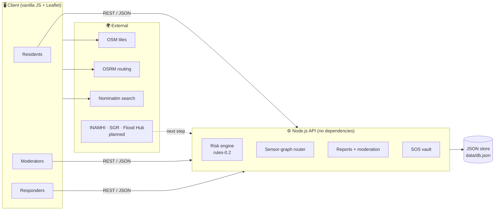
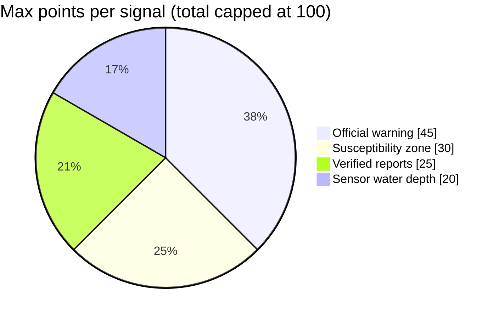
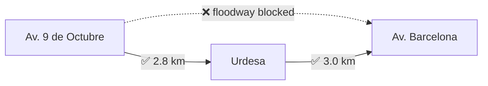

<div align="center">

# 🌊 FloodSense

### Know which road is safe before the water decides for you.

Flood-safety decision-support map for **Guayaquil, Ecuador** · HACK2IMPACT 2026 · Track 1


[Problem](#-problem-statement) · [Solution](#-solution) · [Architecture](#-architecture) · [Quick Start](#-quick-start) · [API](#-api-reference) · [Limits](#-honest-status) · [Team](#-team)

</div>

> ⚠️ **DEMO DATA, NOT FOR REAL EMERGENCY USE.** Sensor readings, zones, alerts and facilities are simulated or fictional samples. In a real emergency call **911**.

---

## 🎯 Problem Statement


> *How can we develop smart solutions that help Guayaquil anticipate and respond better to heavy rains?*

Guayaquil sits near sea level on the Guayas River estuary, and three problems compound during storms:

| 🌊 Tidal locking | 🌧️ Sudden downpours | 🚧 Blocked arterials |
|---|---|---|
| High tides push up the river, so storm canals cannot drain. | Rain can exceed drainage capacity within about 30 minutes. | Av. 9 de Octubre, Barcelona and Urdesa flood, cutting hospital access. |

**The gap:** warnings are city-wide, and navigation apps do not know which street is underwater. Residents and ambulances need street-level, explainable information.

---

## 💡 Solution

FloodSense turns scattered signals into one map that answers: **"Is this place risky right now, and what is the safer way around it?"**

| | Feature | What it does |
|---|---|---|
| 🧮 | **Explainable risk score** | Combines official warning, flood-susceptibility zone, verified reports and nearest sensor. Every score lists its reasons and the data that is *missing*. |
| 🧭 | **Flood-aware routing** | Sensor-marked impassable segments are avoided; a safer alternative is returned. OSRM street routes are scored against zones and verified hazards. |
| 📣 | **Community reports** | Validation, rate limit, duplicates count as corroboration, moderators verify or reject. |
| 🆘 | **SOS with privacy** | Private storage, resident access code, responder status updates, false-alarm cancel. SOS coordinates never appear in public endpoints. |
| 🏥 | **Services directory** | Distance-sorted, with directions; unverified entries are labelled. |
| 🌐 | **Inclusive by design** | Spanish / English, offline-stale banner using cached data with its original timestamp. |


<sub>Interface concept: layered flood map and route options ranked by risk.</sub>

---

## 🏗️ Architecture


<sub>Target architecture. The prototype implements the Node API, risk engine, routing and data layers with a lighter stack, shown below.</sub>

### Prototype data flow



### Technology stack

| Tier | Prototype (built) | Target (planned) |
|---|---|---|
| Client | Vanilla JS, Leaflet, HTML/CSS | React, Tailwind, Leaflet |
| Backend | Node.js 18, built-in `http` | Express / FastAPI |
| Data | JSON file | PostgreSQL + PostGIS |
| Routing | Sensor graph + OSRM public demo | Self-hosted OSRM / NetworkX |
| Auth | Demo role picker, in-memory tokens | Supabase Auth |
| Hosting | Local | Vercel (frontend) + Render (API) |

---

## 🔬 How It Works

### 1. Explainable risk score (`rules-0.2`)



| Level | Score |
|---|---|
| 🟡 Moderate | 20+ |
| 🟠 High | 45+ |
| 🔴 Critical | 70+ |
| ⚪ Insufficient data | no signals available |

It is labelled **"Estimated risk score (not a probability)"**, and the response includes a `missing` list so absence of data is never read as safety.

### 2. Safe routing



1. Model roads as a graph between the five sensor nodes.
2. Mark a segment impassable when its sensor reports critical depth.
3. Run a shortest-path search on the remaining graph.
4. For street routes, rank OSRM alternatives against susceptibility zones and verified hazards.

**Heavy-rain scenario:** tide 2.9 m, rain 42 mm. The 9 de Octubre floodway is blocked, so the route goes via Urdesa (5.8 km).

### 3. Simulated sensor nodes

| Node | Location | Elevation | Normal depth | Heavy-rain depth |
|---|---|---|---|---|
| `GYE-URDESA` | Urdesa Corridor | 2 m | 0.35 m | 0.80 m |
| `GYE-HOSP-IESS` | Hospital IESS | 4 m | 0.12 m | 0.35 m |
| `GYE-DOWNTOWN-9OCT` | Av. 9 de Octubre | 1.5 m | 0.62 m | 1.10 m |
| `GYE-SINAI-VULN` | Monte Sinai | 1 m | 1.25 m | 1.65 m |
| `GYE-BARCELONA` | Av. Barcelona Axis | 3 m | 0.28 m | 0.65 m |

---

## 🚀 Quick Start

**Requirements:** Node.js 18+. No `npm install` needed (zero dependencies). Internet is needed in the browser for map tiles, Leaflet, search and routing.

```bash
git clone https://github.com/Kaironetworks/FloodSense.git
cd FloodSense
node server.js        # http://localhost:3000
node test.js          # API checks: auth, validation, SOS privacy, simulated sensors
```

Use another port with `PORT=4000 node server.js`.

### 🎬 Demo walkthrough (about 2 minutes)

1. Open `http://localhost:3000`, switch to the **Ops** tab and sign in with a demo role.
2. Run the **guided 6-step scenario**: report → corroborate → verify → route → SOS → responder acknowledgement.
3. Click any point on the map to see its estimated risk score and reasons.
4. Plan a route and compare alternatives; try the heavy-rain sensor scenario below.

```bash
curl "http://localhost:3000/api/flood/sensors?scenario=heavy"
curl "http://localhost:3000/api/flood/route?from=GYE-DOWNTOWN-9OCT&to=GYE-BARCELONA&scenario=heavy"
curl "http://localhost:3000/api/flood/assessments?lat=-2.1944&lng=-79.8883"
```

---

## 🔌 API Reference

| Area | Endpoints |
|---|---|
| Health and sources | `GET /api/health` · `GET /api/sources/status` |
| Flood data | `GET /api/flood/zones` · `GET /api/flood/sensors` · `GET /api/flood/route` · `GET /api/flood/assessments` |
| Alerts and incidents | `GET /api/alerts` · `GET /api/incidents` |
| Community reports | `POST /api/reports` · `POST /api/reports/:id/verify` · `POST /api/reports/:id/resolve` |
| SOS | `POST /api/sos` · `GET /api/sos/:id` · `POST /api/sos/:id/cancel` |
| Responders | `GET /api/responder/incidents` · `PATCH /api/responder/incidents/:id/status` |
| Services | `GET /api/shops` · `GET /api/safe-locations` |
| Admin | `GET /api/admin/overview` · `GET /api/admin/audit-logs` · `POST /api/admin/reset-demo` |

Sample sensor payload:

```json
{
  "id": "GYE-SINAI-VULN",
  "name": "Monte Sinai",
  "elevationM": 1,
  "waterDepthM": 1.65,
  "roadStatus": "IMPASSABLE",
  "dataStatus": "SIMULATED_UNVERIFIED"
}
```

---

## 📁 Project Structure

```text
FloodSense/
├── server.js          # Node HTTP server: API, risk engine, router, SOS
├── test.js            # API test suite
├── package.json       # scripts only, zero dependencies
├── public/
│   ├── index.html     # app shell
│   ├── app.js         # map, panels, ES/EN, offline banner
│   └── samples/       # sample SVG assets
├── data/
│   ├── db.json        # demo database (JSON)
│   └── uploads/       # report photo placeholders
├── docs/              # architecture, UI concept, problem statement images
├── LICENSE            # MIT
└── README.md
```

---

## ✅ Honest Status

| Item | Status |
|---|---|
| Map, risk score, routing, reports, SOS, ES/EN, offline banner | ✅ Working |
| 5 simulated sensor nodes with heavy-rain scenario | ✅ Working (simulated, labelled) |
| INAMHI, SGR flood-susceptibility MapServer, Google Flood Hub | ⏳ Not connected (`not_configured`) |
| Zones, alerts, facilities | ⚠️ Fictional samples |
| Database | ⚠️ JSON file, not PostgreSQL / PostGIS |
| Auth | ⚠️ Demo role picker, no passwords / CSRF / 2FA |
| Photos, EXIF stripping, push / email / SMS, live updates | ⏳ Not implemented |

## 🛣️ Roadmap

- [ ] Query the SGR `Susceptibilidad_de_Inundaciones` MapServer (`?f=geojson`) and load polygons into PostGIS
- [ ] INAMHI adapter and Flood Hub adapter (approved key kept in server env only)
- [ ] Open-Meteo 1 to 3 hour rainfall forecast feed
- [ ] Replace demo auth with Supabase Auth; move to Postgres; add uploads and live updates
- [ ] SMS-style low-bandwidth alerts for Isla Trinitaria and Monte Sinai

---

## 👥 Team

| Role | Name |
|---|---|
| 🧑‍💻 Team Lead and repository owner | **Rithish R** |
| 🧑‍💻 Team Member | **Guhan S** |

Built for **HACK2IMPACT 2026**, IEEE-HKN Founders Day Hackathon (Nu Eta, Sri Sairam Engineering College × Nu Zeta, ESPOL).

## 🙏 Acknowledgements and Citations

- Map data © [OpenStreetMap](https://www.openstreetmap.org/copyright) contributors; tiles and search by OSM and Nominatim
- Routing by the public [OSRM](https://project-osrm.org/) demo server (no SLA)
- Maps rendered with [Leaflet](https://leafletjs.com/)
- Track brief and problem statement: HACK2IMPACT 2026 handbook

## 📄 License

Released under the [MIT License](LICENSE).
