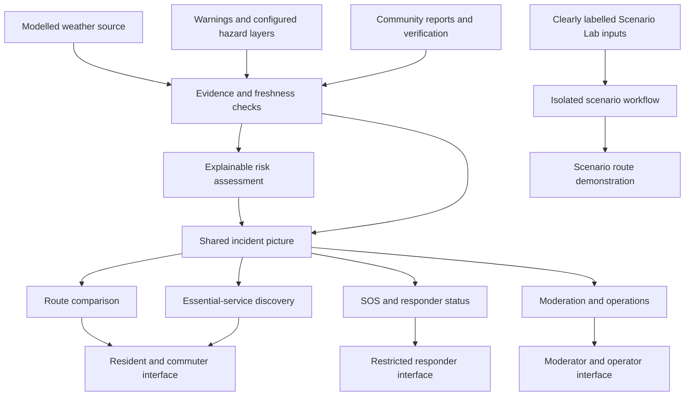

# FloodSense

### City-adaptive flood intelligence. Safer decisions when every minute matters.

**See the risk. Share the evidence. Coordinate the response.**

<p>
  
  
  
  
</p>

*An urban resilience platform concept developed for the
Rain-Resilient Cities challenge, using Guayaquil, Ecuador, as its
initial demonstration environment.*

</div>

---

## Abstract

Flooding is not only a weather problem. It becomes a city-wide emergency when people cannot tell which roads may be blocked, whether a reported hazard is credible, where help is needed, or which essential services may still be reachable.

**FloodSense connects those decisions in one place.** It brings together
risk assessment, community observations, safer-route exploration,
essential-service discovery, SOS workflows, and responder operations—so
that residents and response teams can work from a shared operational
picture.

The goal is not to claim certainty where none exists. It is to make
available evidence easier to interpret, surface missing or stale
information, and help people make better-informed decisions under
pressure.

## Why FloodSense?

| The real-world problem                                                                       | FloodSense’s response                                                                                                            |
|----------------------------------------------------------------------------------------------|----------------------------------------------------------------------------------------------------------------------------------|
| Rainfall and flooding can vary sharply between neighbourhoods.                               | Assess conditions at a location and expose the evidence and uncertainty behind the estimate.                                     |
| Official feeds may be delayed, incomplete, or unavailable.                                   | Distinguish known information from missing, stale, sample, or simulated data instead of silently treating gaps as safety.        |
| A route that is shortest on a map may cross a hazard.                                        | Compare route alternatives against available hazard zones and verified road reports, while making fallback limitations explicit. |
| Residents often have useful local observations, but reports may be duplicated or unreliable. | Provide a structured reporting and moderation workflow with corroboration and resolution states.                                 |
| A distress request needs a clear status and controlled access.                               | Keep SOS records separate from public incident listings and provide a responder-facing status workflow.                          |
| Emergency response involves more than predicting water.                                      | Connect incident reporting, essential services, response coordination, and operational oversight in one prototype.               |

## One platform, multiple roles

FloodSense is designed around a shared incident picture rather than
disconnected tools. Each role has a different job, while the underlying
reports and workflows remain connected.

<details>
<summary>
<strong>Residents and commuters</strong>
</summary>

- Review estimated local risk and available warnings.
- Report flooding, blocked roads, debris, drainage issues, and other
  hazards.
- Explore route alternatives and nearby essential services.
- Create and track a prototype SOS request.
- See when information is cached, stale, or unavailable.

</details>
<details>
<summary>
<strong>Moderators and community verifiers</strong>
</summary>

- Review incoming reports.
- Verify, reject, or resolve reports.
- Reduce duplicate noise and preserve a history of moderation actions.
- Help distinguish a single unverified observation from corroborated
  information.

</details>
<details>
<summary>
<strong>Responders</strong>
</summary>

- Review response incidents through a restricted workflow.
- Acknowledge, assign, update, or resolve an incident.
- Track the status of SOS requests without exposing sensitive SOS
  details in public incident feeds.

</details>
<details>
<summary>
<strong>Administrators and operators</strong>
</summary>

- Review operational summaries and source-health indicators.
- Manage selected operational content and demo workflows.
- Inspect audit activity and use the prototype’s guided scenario flow.

</details>

> **Prototype boundary:** these are demonstration roles and workflows,
> not verified institutional accounts or a connection to an official
> emergency-dispatch system.

## How the system fits together



The diagram represents the logical product architecture. It does not mean that every data source is live, every location has validated hazard coverage, or that FloodSense is connected to an official emergency-dispatch system.

## Two distinct modes: live context and Scenario Lab

FloodSense separates the available weather context from controlled demonstrations.

<details>
<summary><strong>Live Conditions — modelled weather</strong></summary>

The application requests current weather data from Open-Meteo for a configured point in Guayaquil. The interface distinguishes the provider's model time from the time FloodSense retrieved the response.

- Source and source type are identified.
- Modelled precipitation is not described as a direct rain-gauge measurement.
- A failed refresh can leave a cached value visible only with a stale warning.
- If no value is available, the interface says so instead of inventing a replacement.
- City-grid weather cannot establish street-level flood depth or prove a road is safe.

The current weather integration is a **modelled weather feed**, not a verified municipal sensor network or an official flood warning.
</details>

<details>
<summary><strong>Scenario Lab — controlled simulation</strong></summary>

The heavy-rain scenario uses deterministic sample sensors and an illustrative road graph to demonstrate how a simulated impassable segment can change the preferred path.

- Simulated rainfall, water depth, elevation, and road status are explicitly labelled.
- Scenario routing does not change the live weather feed.
- The guided scenario timeline uses browser-local demonstration steps rather than writing fake incident and SOS records into the shared incident database.
- Scenario results are not forecasts, observed incidents, or safe-navigation guarantees.
</details>

## One platform, multiple roles

<details>
<summary><strong>Residents and commuters</strong></summary>

- Review estimated local risk and available weather context.
- Report flooding, blocked roads, debris, drainage issues, and other hazards.
- Explore route alternatives and configured essential services.
- Create and track a prototype SOS request.
- See when information is cached, stale, simulated, or unavailable.
</details>

<details>
<summary><strong>Moderators and community verifiers</strong></summary>

- Review incoming reports.
- Verify, reject, or resolve reports.
- Review nearby duplicates and corroborating observations.
- Preserve the state and history of moderation actions.
</details>

<details>
<summary><strong>Responders</strong></summary>

- Review incidents through a restricted workflow.
- Acknowledge, assign, update, or resolve response records.
- Access SOS details through the responder workflow rather than public incident listings.
</details>

<details>
<summary><strong>Administrators and operators</strong></summary>

- Review operational summaries and source-health indicators.
- Manage selected operational content and demonstration workflows.
- Inspect audit activity and review reports that require attention.
</details>

These are demonstration roles, not verified institutional identities or production-grade access controls.

## Resilience is a data-quality problem

**Missing information is not evidence that conditions are safe.**

| Situation | FloodSense behaviour |
|---|---|
| Weather source returns a recent response | Display its model time, retrieval time, source, and modelled-data caveat. |
| Weather refresh fails but a cached response exists | Preserve the original timestamps and mark the value stale. |
| No weather value is available | Show unavailable state; do not fabricate a reading. |
| Location is outside configured Guayaquil coverage | Return an insufficient-coverage result instead of applying Guayaquil's sample hazards to arbitrary GPS coordinates. |
| A community report is unverified | Keep its verification state visible. |
| A route provider is unavailable | Do not present a failed or straight-line fallback as safe navigation. |
| Browser is offline | Label cached data and any locally queued SOS as not sent. |
| Scenario Lab is active | Identify its inputs as simulation and keep them separate from the live weather response. |

These are implemented behaviours where stated; they do not mean that every possible failure mode has been eliminated.

## SOS: separate from weather, honest about delivery

An SOS request must not depend on a successful weather API call. FloodSense keeps SOS submission separate from weather assessment and distinguishes three different states:

1. **Saved locally:** an offline request is stored in this browser only. It is labelled **NOT SENT — WAITING FOR CONNECTION**.
2. **Accepted by the FloodSense server:** the server has returned an incident reference and access code.
3. **Real-world help dispatched:** this is **not supported** by the current prototype; official emergency dispatch is not connected.

When connectivity returns while the page is open, the browser can retry locally queued requests. A request ID allows the server to recognize a retry and avoid creating a duplicate record. Local queuing is not a substitute for emergency communication, and browser storage is not a guaranteed delivery channel.

**If someone is in immediate danger, contact the relevant local emergency service directly.** For the current Guayaquil demonstration, the interface links to Ecuador's emergency number, 911.

## City-adaptive by design

FloodSense is intended to reuse the same workflows across cities while keeping local assumptions configurable.

- **Shared engine:** evidence handling, freshness checks, explainable assessment, report lifecycle, route comparison, SOS status, and role-aware operations.
- **City profile:** local coordinates and coverage, hazard layers, official sources, service directories, languages, thresholds, and emergency references.
- **Scenario profile:** controlled hazards used to exercise workflows without presenting simulated conditions as live alerts.

**Current coverage is Guayaquil, Ecuador.** Other cities are not automatically covered just because a user can select a GPS location. Until a city has its own configured and validated sources and hazard layers, the system should report insufficient coverage rather than reuse Guayaquil demo data.

Flood behaviour differs by terrain, drainage, rivers, coastlines, rainfall patterns, road networks, and local response procedures. City-specific models and data need local validation; one city's thresholds must not be treated as universal.

## Technology

| Layer | Current implementation |
|---|---|
| Server | Node.js built-in HTTP server (Node.js 18+) |
| Interface | HTML, CSS, browser-native JavaScript |
| Interactive map | Leaflet with OpenStreetMap tiles |
| Weather context | Open-Meteo forecast API, accessed server-side |
| Routing | OSRM public routing service for route alternatives; local deterministic graph for the isolated heavy-rain scenario |
| Evidence fusion | Deterministic rules in `evidence.js` for freshness, confidence, conflicts, hazard state, and consequences |
| Prototype persistence | Local JSON file (`data/db.json`) and local uploads |
| Browser resilience | Cached views, stale/offline indicators, and a local pending SOS queue |
| Validation | Node-based API regression tests and JavaScript syntax checks |

The lightweight stack keeps the prototype straightforward to run and inspect. It is not an assertion that JSON-file persistence or public demonstration services are suitable for mission-critical emergency operations.

## Quick start

Requirements: Node.js 18 or newer. No third-party npm packages are required by the current prototype.

```bash
npm start
```

Open `http://localhost:3000`. The interactive map, map tiles, address search, and public routing depend on external services and may be unavailable without internet access. Weather failure should produce an explicit unavailable/stale state rather than a fabricated value.

Run the included regression suite with `npm test`.

## API surface

The server exposes focused endpoints for:

- `/api/health` and `/api/sources/status` — application and integration health
- `/api/weather/current` — modelled weather, provenance, timestamps, and freshness
- `/api/flood/assessments` and `/api/flood/intelligence` — location assessment and evidence fusion
- `/api/flood/sensors` and `/api/flood/route` — labelled deterministic scenario inputs and route demonstration
- `/api/flood/replay` — isolated evidence-fusion evaluation
- `/api/incidents` and `/api/reports` — community incident workflow
- `/api/sos` and `/api/responder/incidents` — private SOS and responder workflow
- `/api/safe-locations`, `/api/shops`, and `/api/chat` — configured services and community information

Endpoint availability does not imply a live official integration. The source-health panel identifies integrations that are not configured.

## Trust boundaries and limitations

FloodSense is a **research and demonstration prototype**, not a certified flood-warning or emergency-dispatch system.

- **Risk model:** deterministic and explainable, but not a calibrated probability or validated machine-learning forecast.
- **Weather:** modelled city-grid weather is not a direct rain-gauge observation and does not establish street-level inundation.
- **Hazard layers and sensors:** configured susceptibility polygons, sensor values, elevation, drainage, and scenario roads may be samples or simulations.
- **Official data:** a complete verified municipal sensor network and official warning adapter are not currently connected.
- **Services:** sample facility locations may be incomplete or unverified; availability and accessibility are not guaranteed.
- **Routing:** depends on the external road network, routing service, hazard evidence, and report freshness. No route is guaranteed safe through floodwater.
- **Authentication:** demo roles are not production identity assurance. Privileged demo roles are intentionally restricted by local configuration.
- **Persistence:** JSON-file storage is not designed for high-concurrency writes, transactional recovery, or mission-critical operations.
- **SOS:** no official dispatch integration or guaranteed responder delivery.
- **Offline behaviour:** local storage and retry improve continuity but do not create a communication channel where none exists.

Never walk, drive, or wade through floodwater based solely on a map or score. Follow verified local authority instructions.

## Next engineering priorities

- [ ] Integrate approved live weather and official warning sources with
  source attribution and retrieval timestamps.
- [ ] Add per-source freshness rules and explicit confidence/uncertainty
  handling.
- [ ] Replace sample hazard layers and service entries with verified,
  maintained city data.
- [ ] Strengthen risk-aware routing with validated road-closure and
  flood-depth evidence where available.
- [ ] Ensure SOS submission, retry, and delivery states are explicit and
  independently tested.
- [ ] Add a robust database, durable audit records, and production
  authentication before any real deployment.
- [ ] Validate the risk logic against documented events and local expert
  review before making predictive claims.
- [ ] Package the responsive interface as a progressive web app only
  after offline behaviour is tested end to end.
- [ ] Add city profiles through configuration and source adapters rather
  than copying the application for each city.

## Project context

FloodSense was developed for **Rain-Resilient
Cities**, with Guayaquil, Ecuador, as the initial challenge setting.

The broader ambition is a reusable urban-resilience platform: one that
helps communities and response teams make evidence-aware decisions
during disruptive events, while clearly communicating what the system
knows, what it does not know, and what it has actually delivered.

------------------------------------------------------------------------

<div align="center">

**FloodSense**  
*City-adaptive flood intelligence for safer decisions and coordinated urban response.*

</div>
